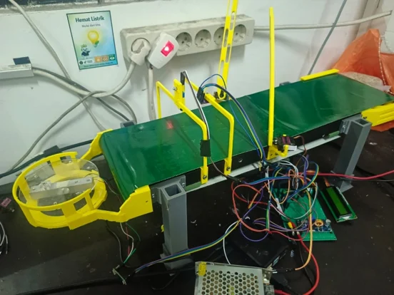
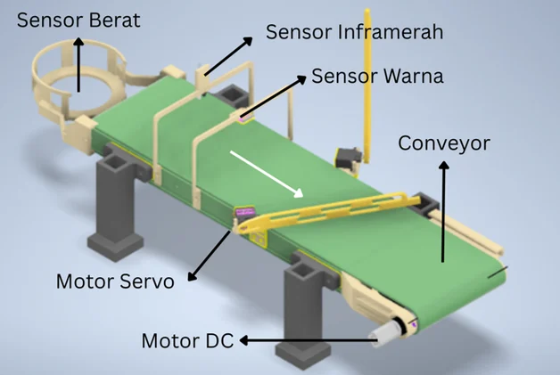
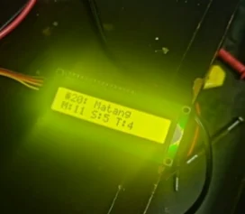

# Tomato Ripeness Classification with SVM-PSO on Raspberry Pi

A conveyor that sorts tomatoes into **unripe / partially ripe / ripe** in real time. A TCS34725 colour sensor reads RGB-C values, a Raspberry Pi 4 classifies them with a **Support Vector Machine tuned by Particle Swarm Optimization (SVM-PSO)**, and a servo sends each tomato to its bin.

My final-year thesis in Electrical Engineering, Brawijaya University (2026).

<p align="center">
  
  
</p>

<p align="center">
  
</p>

> The physical prototype is no longer available, so `deploy/sorter.py --simulate` reproduces the sorting loop on any computer.
> Full thesis (Indonesian): [`docs/thesis.pdf`](docs/thesis.pdf).

## Results

Test set: 77 readings (stratified 80/20 split of 381 readings).

| Model | Accuracy | Precision | Recall | F1-score |
|---|---|---|---|---|
| K-Means (k=3, unsupervised baseline) | 84.42% | 85.46% | 84.26% | 84.29% |
| SVM, RBF kernel, default parameters | 89.61% | 90.37% | 89.44% | 89.46% |
| **SVM-PSO, RBF kernel** (C = 20.59, γ = 9.70) | **90.91%** | **91.88%** | **90.72%** | **90.72%** |

**Real-time test on the conveyor:** 45 new tomatoes (15 per class) → **80.00%** overall.

| Actual \ Predicted | Unripe | Partially ripe | Ripe | Accuracy |
|---|---|---|---|---|
| Unripe | **12** | 3 | 0 | 80.00% |
| Partially ripe | 1 | **11** | 3 | 73.33% |
| Ripe | 0 | 2 | **13** | 86.67% |

### What the numbers mean
- **Supervised learning clearly beats clustering:** +5.2 points from K-Means to SVM.
- **PSO's gain on the RBF kernel is small:** +1.3 points, which is one test sample. Bootstrap standard deviation is about 3.3 points, so that difference **is not statistically significant**. Where PSO really mattered was the sigmoid kernel: 3.9% with default parameters, 90.9% after tuning.
- **Partially ripe is the hard class.** Its colour sits between the other two, and most errors involve it, both offline and on the conveyor.
- **Accuracy dropped from 90.9% offline to 80% on the conveyor.** Likely causes:
  - lighting on the open conveyor differed from the closed box used to collect data;
  - the offline split was per reading, so readings of the same tomato could appear in both train and test (see [Limitations](#limitations--next-steps)).

## How it works

```
HX711 load cell ──► weight in 30–72 g? ──► IR sensor triggers ──► conveyor slows
                                                                     │
servo → bin ◄── LCD shows class ◄── SVM-PSO (RPi 4) ◄── TCS34725 ×5 reads, averaged
```

| Stage | Details |
|---|---|
| Sensor | TCS34725, integration time 50 ms, gain 4×, ~3 cm from the fruit, built-in white LED, closed box |
| Data | 381 readings from 82 tomatoes: unripe 130, partially ripe 121, ripe 130 |
| Preprocessing | Drop readings with Clear < 500; features `R/C, G/C, B/C` remove light-intensity effects |
| Baseline | K-Means (k=3, k-means++, 10 inits), clusters mapped to the majority label |
| Models | SVM with polynomial, sigmoid and RBF kernels |
| Tuning | PSO: 20 particles, 100 iterations, inertia 0.9→0.4, c1 = c2 = 2.0, fitness = mean 5-fold CV accuracy |
| Search space | C ∈ [0.01, 1000], γ ∈ [0.0001, 10], r ∈ [−1, 1], d ∈ [1, 5] |
| Hardware | Raspberry Pi 4B, TCS34725 (I²C), IR sensor, HX711 load cell, DC motor + L298N (pigpio PWM), two servos as a sorting gate, 16×2 I²C LCD |

Mean normalized features per class show why colour works. Rnorm falls as ripeness falls, and Gnorm rises:

| Class | Rnorm | Gnorm | Bnorm |
|---|---|---|---|
| Ripe | 0.659 | 0.234 | 0.150 |
| Partially ripe | 0.552 | 0.307 | 0.138 |
| Unripe | 0.470 | 0.359 | 0.171 |

## Run it

```bash
git clone https://github.com/<your-username>/tomato-ripeness-svm-pso.git
cd tomato-ripeness-svm-pso
python -m venv .venv && source .venv/bin/activate
pip install -e ".[dev]"

# Train + compare all models (writes results/ and models/svm_pso.joblib)
python -m tomato.train --data data/sample_readings.csv          # or your dataset_tomat.xlsx

# Run the real-time sorter without hardware
python deploy/sorter.py --model models/svm_pso.joblib --simulate --items 10

# Tests
pytest
```

The full 381-reading dataset isn't included; `data/sample_readings.csv` holds the 30 example readings printed in the thesis, so everything runs out of the box. See [`data/README.md`](data/README.md) for the formats accepted, including the thesis spreadsheet.

On the Raspberry Pi: `pip install -r requirements-pi.txt`, start `pigpiod` with `sudo systemctl start pigpiod`, then run `deploy/sorter.py` without `--simulate`.

### Repository layout
There are two versions of the training code: the original thesis program, and a refactored version of it.

```
thesis_code/
  train_svm_pso.py   original training program from the thesis appendix (Lampiran 3), restored to run
deploy/
  sorter.py          original Raspberry Pi program (Lampiran 2), restored, with a --simulate mode
src/tomato/          refactored, tested version of the training pipeline
  features.py        filtering + R/C, G/C, B/C normalization
  pso.py             particle swarm optimizer (linear inertia decay, velocity clamping)
  models.py          SVM search spaces, K-Means baseline classifier
  train.py           baseline vs default SVM vs SVM-PSO, bootstrap std, plots, --split group
tests/               unit tests + an end-to-end run of the sorter in simulation
```

**`thesis_code/train_svm_pso.py`** is the code from the thesis appendix with only the fixes needed to run it:
- a broken import;
- three variables that were used but never defined;
- PDF indentation.

Its PSO search reproduces the thesis's optimal RBF parameters (C = 20.59, γ = 9.6958) from the same random seed. It picks the final kernel by test accuracy, as in the thesis.

**`src/tomato/`** picks the kernel by cross-validation fitness instead, so the test set stays untouched until the end. It also adds the group-wise split.

## Limitations & next steps

These come straight from the thesis conclusions and are the plan for v2:

- [ ] **Group-wise split by fruit.** `python -m tomato.train --split group` keeps every reading of a tomato on one side of the split. It needs a `fruit_id` column, and it should give a more honest offline score.
- [ ] **Use weight as a feature**, not just as an object check.
- [ ] **Cover the sensor area on the conveyor** so lighting matches the data-collection box.
- [ ] **More samples from the transition zone** between unripe and partially ripe.
- [ ] **Compare with Random Forest and a small neural network.**
